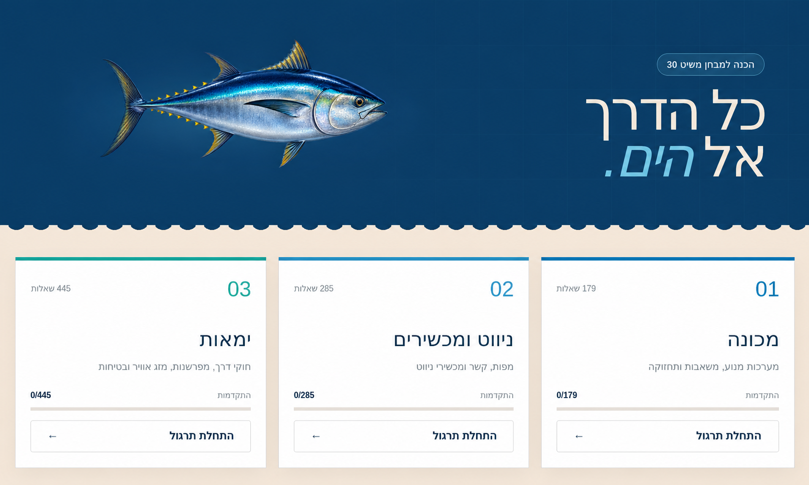

<div align="center">

# Skipper 30 and 60 Quiz 🌊

### Interactive preparation for Israel's Skipper 30 and 60 exams

A complete Hebrew question bank with Russian and English translation help and a mobile-first practice experience.

[**Open the app**](https://mitkonenim-layam.sapirp.chatgpt.site)


</div>



---

## About

**Skipper 30 and 60 Quiz** is a web application for practicing questions for Israel's Skipper 30 and 60 exams. Sections 01–04 cover Skipper 30; section 05, GMDSS, covers Skipper 60. The home banner names both exams, and each subject card displays its exam level in its accent color. Choose a subject, work through every question (theory topics are randomized; practical preparation and GMDSS follow their source documents), and use optional Russian or English translations beneath each question when needed.

Progress resets whenever the page is refreshed. The three theory topics shuffle questions once at the beginning of each new session. Practical preparation and GMDSS always follow document order, including the relative order in mistake retries. Answer choices are also shuffled, except for questions whose answers refer to their original letter positions, preceding choices, or labeled elements in an image. Their order remains stable while navigating backward and forward through that session.

## Features

- **1,240 questions** across five subjects
- **177** engine questions
- **264** navigation and instruments questions
- **373** seamanship questions
- **210** practical-preparation questions (הכנה למעשי), in document order
- **216** GMDSS questions for Skipper 60, in document order, with a violet section 05 card and exam badge
- **171 unique question images** referenced by the current bank
- Correct and incorrect answers highlighted immediately after selection
- Optional, non-interactive Russian and English translations for all questions and answers
- Previous and Next navigation available throughout a session
- Selected answers and answer order preserved when revisiting questions
- Answer randomization at the start of each session, with source order preserved for 78 order-dependent questions (25 theory, 24 practical and 29 GMDSS)
- Unrestricted access to every question in the selected subject
- Tap-to-enlarge question images with lazy loading
- Complete Hebrew and right-to-left interface support
- Responsive layouts for iPhone, iPad, and Android devices
- Landscape orientation and safe-area support
- Accessible touch targets and accidental-exit protection
- Service Worker caching for repeat use on slow or interrupted connections

## How It Works

1. Select one of the five subjects using its Skipper 30 or Skipper 60 badge.
2. The app keeps practical and GMDSS questions in document order and shuffles theory questions. Most answer choices shuffle once per session; order-dependent choices retain their source order.
3. Open **Перевод на русский** or **Translation to English** when translation help is useful.
4. Select an answer to reveal whether it is correct.
5. Use Previous and Next to move through the stable session order.
6. Continue until you have completed the entire subject bank.

## Local Development

### Requirements

- Node.js `22.13.0` or later
- npm

### Setup

```bash
npm install
npm run dev
```

The development URL will be displayed in your terminal.

### Commands

| Command | Description |
|---|---|
| `npm run dev` | Start the local development server |
| `npm run build` | Create a production-ready build |
| `npm test` | Build and run the project tests |
| `npm run lint` | Check code quality |

## Project Structure

```text
app/
├── quiz-app.tsx        # Quiz interface and application logic
├── quiz-session.ts     # Topic configuration and session ordering
├── questions.json     # Complete 1,240-question bank
├── questions.en.json  # English question and answer translations
├── questions.ru.json  # Russian question and answer translations
├── globals.css        # Responsive styling and animations
└── layout.tsx         # Application shell and viewport metadata
public/
├── question-images/   # Images used by the questions
├── tuna.png           # Animated tuna illustration
└── sw.js              # Offline cache service worker
tests/                 # Rendering and translation coverage tests
scripts/
├── import_practical_questions.py # Import or verify the practical DOCX
├── import_gmdss_questions.py # Import or verify the GMDSS DOCX
└── translate_questions.mjs # Regenerate Russian or English translations
```

## Technology

- [React 19](https://react.dev/)
- [TypeScript](https://www.typescriptlang.org/)
- [vinext](https://github.com/cloudflare/vinext)
- [Vite](https://vite.dev/)
- [Cloudflare Workers](https://developers.cloudflare.com/workers/)

## Question Data

The question bank was extracted from five Word documents. Answers highlighted with a green background in the source documents were recorded as correct. Duplicate questions were removed from the theory and GMDSS imports. All 210 practical questions are retained in source order, including the two three-choice questions and 29 original illustrations. The practical importer reads numbered question paragraphs and green shading (`#92D050`), because both questions and correct answers can be bold.

Import practical preparation with `python3 scripts/import_practical_questions.py "/path/to/qa maasi.docx"`. This updates only the practical topic and its image assets. Add `--check` to verify the stored questions and image bytes against the document without changing files. Ambiguous answer markings stop the import instead of dropping questions.

The practical question data carries `sourceIndex` and `preserveAnswerOrder`. All 24 questions with letter-dependent choices preserve the entire answer list, even when the dependent choice is incorrect. Practical English/Russian help uses numbered choice references to match the translated lists.

Import GMDSS with `python3 scripts/import_gmdss_questions.py "/path/to/gmdss.docx"`; add `--check` to compare stored data with the source without writing. Its 251 source questions yield 216 entries after removing 16 document duplicates and 19 already present in navigation. Stable IDs retain the original source indices. The importer identifies bold question text, including two questions with unusual paragraph styles, and requires four choices with exactly one green (`#92D050`) answer. Seven reviewed wording/spelling equivalents are protected by complete content fingerprints. Conflicting answer keys are reported and retained. All 29 GMDSS questions with positional references preserve answer order, including incorrect combinations and references to preceding choices. English and Russian translations were authored locally; choice-letter references use the translation panels' numbered lists.

The GMDSS source needs editorial review: questions 66 and 105 have the same prompt and choices but mark different answers green. Question 121 asks about radio silence but supplies an unrelated DSC answer as correct. These source markings are preserved. Questions with different distractors or conflicting keys are retained as separate records.

Importer regression checks: `python3 -m unittest discover -s tests -p 'test_*.py'`.

Translations are stored in `app/questions.ru.json` and `app/questions.en.json`, keyed by question ID and the original Hebrew answer text. Regenerate Russian with `node scripts/translate_questions.mjs` and English with `node scripts/translate_questions.mjs en`. These commands send Hebrew content to Google Translate and replace the selected translation file, including locally authored translations, so review the resulting nautical terminology before publishing.

> This application is an independent study aid and is not an official website of Israel's Shipping and Ports Administration.

---

<div align="center">

Built to make the path to the exam clearer—and bring you a little closer to the sea.

</div>
